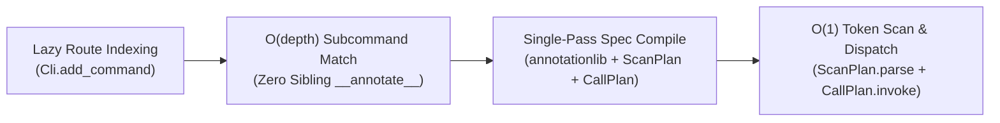
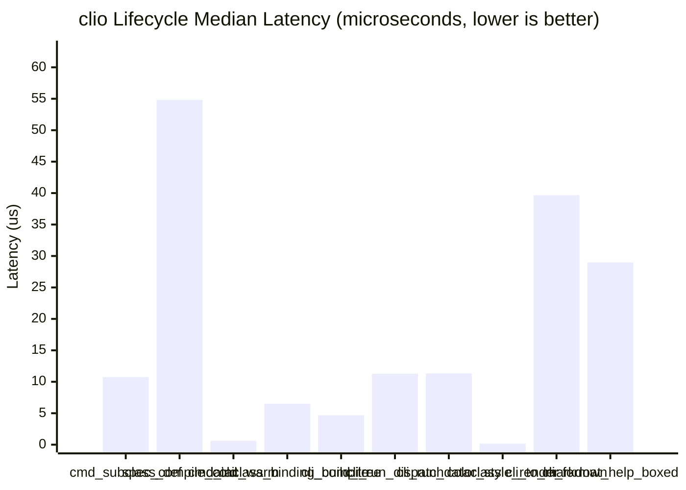

# Performance & Architecture Benchmarks

`clio` is engineered around a strict **Stateless Specification / Stateful Execution** split
built natively on Python 3.14's `annotationlib` (PEP 649 / PEP 749) and a custom zero-`argparse`
token scanner (`ScanPlan`). Expensive introspection (`annotationlib`, `inspect.signature`,
PEP 695 `TypeAliasType` unwrapping, docstring parsing, `Annotated[T, Arg(...)]` extraction,
and `@dataclass` field binding) happens **lazily on the matched command path only** and is
cached in immutable `@dataclass(frozen=True, slots=True)` specifications.

!!! info "Benchmark Environment"
    - **Runtime**: `Python 3.14.3 (CPython)`
    - **Platform**: `Darwin 25.5.0 (arm64)`
    - **Suite**: `tests/test_benchmarks.py` (enforced in `pytest` and `prek.toml`)

## Lifecycle Architecture



## Micro-Benchmark Results

| Benchmark | Category | Median (µs) | Mean (µs) | P95 (µs) | Min (µs) | Throughput (ops/s) | Budget (µs) |
| :--- | :--- | ---: | ---: | ---: | ---: | ---: | ---: |
| **Command Subclass Definition**<br><small>Define a `Command` subclass (`__init_subclass__` with PEP 649 lazy `__annotate__`).</small> | `Compile` | `10.75` | `10.93` | `18.58` | `4.33` | `93,023` | `<= 250` |
| **Cold CommandSpec Compilation**<br><small>Single-pass cold introspection (`annotationlib` + `ScanPlan.compile` + `CallPlan.compile`).</small> | `Compile` | `54.83` | `65.19` | `60.50` | `52.04` | `18,237` | `<= 2000` |
| **Warm Command Instantiation**<br><small>Instantiate a `Command` subclass when `CommandSpec` is already cached on the class.</small> | `Runtime` | `0.62` | `0.62` | `0.67` | `0.54` | `1,600,000` | `<= 50` |
| **DataclassCommand Spec Compilation**<br><small>Wrap a `@dataclass(frozen=True, slots=True)` via `Command.from_dataclass()` with cached `DocstringSpec`.</small> | `Compile` | `6.50` | `6.51` | `6.67` | `6.29` | `153,846` | `<= 2000` |
| **Lazy CLI Route Indexing**<br><small>Construct `Cli` and lazily index `Command`, `CommandGroup`, and `@dataclass` routes without evaluating `__annotate__`.</small> | `Build` | `4.67` | `9.55` | `12.67` | `4.42` | `214,270` | `<= 250` |
| **ScanPlan Parse & CallPlan Dispatch**<br><small>End-to-end `cli.run([...])` native `ScanPlan.parse()` and fast-path `CallPlan.invoke()` dispatch.</small> | `Runtime` | `11.29` | `17.69` | `36.29` | `11.00` | `88,558` | `<= 250` |
| **Frozen @dataclass CLI Hydration**<br><small>End-to-end `cli.run([...])` hydrating a `@dataclass(frozen=True, slots=True)` payload.</small> | `Runtime` | `11.33` | `15.87` | `35.58` | `10.96` | `88,238` | `<= 250` |
| **Style Composition & ANSI Helpers**<br><small>Compose frozen `Style` objects, format text, and compute `Colors.visible_len()`.</small> | `Runtime` | `0.17` | `0.18` | `0.21` | `0.12` | `5,988,024` | `<= 100` |
| **Zero-Dependency Markdown Generation**<br><small>Render complete CLI reference documentation via `cli.to_markdown()`.</small> | `Docs` | `39.67` | `40.91` | `43.29` | `37.79` | `25,210` | `<= 2500` |
| **Boxed Multi-Column ANSI Help**<br><small>Render Unicode boxed multi-column `--help` panels via `HelpFormatter` and `Colors.box()`.</small> | `Docs` | `28.98` | `29.71` | `35.71` | `27.29` | `34,507` | `<= 1500` |

### Median Latency Breakdown (µs)



## Frozen Slotted Specification Footprint

Every specification and configuration object in `clio` uses `@dataclass(frozen=True, slots=True)`
to eliminate per-instance `__dict__` allocation and prevent accidental state mutation across runs.

| Dataclass | Module | Shallow Size (Bytes) | Frozen | Slotted | Architectural Role |
| :--- | :--- | ---: | :---: | :---: | :--- |
| [`Arg`](reference.md) | `clio.docstr` | `88` | `Yes` | `Yes` | Declarative Annotated[T, Arg(...)] CLI flag & env metadata |
| [`ParameterSpec`](reference.md) | `clio.docstr` | `88` | `Yes` | `Yes` | Introspected parameter type, default, Arg metadata, and coercion |
| [`DocstringSpec`](reference.md) | `clio.docstr` | `64` | `Yes` | `Yes` | Parsed docstring summary, body, and parameter map |
| [`OptionBinding`](reference.md) | `clio.parser` | `48` | `Yes` | `Yes` | Flag-to-ParameterSpec binding entry in ScanPlan |
| [`ScanPlan`](reference.md) | `clio.parser` | `64` | `Yes` | `Yes` | Pre-compiled O(1) strict CLI token scanner |
| [`ScanResult`](reference.md) | `clio.parser` | `72` | `Yes` | `Yes` | Immutable scanned parameter dictionary and mode flags |
| [`HelpFormatter`](reference.md) | `clio.parser` | `96` | `Yes` | `Yes` | Zero-dependency ANSI usage and multi-section help renderer |
| [`DataclassBinding`](reference.md) | `clio.command` | `64` | `Yes` | `Yes` | Pre-computed @dataclass field binding for CLI hydration |
| [`CallPlan`](reference.md) | `clio.command` | `104` | `Yes` | `Yes` | Pre-compiled sync/async dispatch plan replacing inspect.signature() |
| [`CommandSpec`](reference.md) | `clio.command` | `88` | `Yes` | `Yes` | Cached command specification (name, help, ScanPlan, CallPlan) |
| [`PackageMeta`](reference.md) | `clio.cli` | `104` | `Yes` | `Yes` | Extracted PEP 621 package metadata from importlib.metadata |
| [`CliConfig`](reference.md) | `clio.cli` | `96` | `Yes` | `Yes` | Immutable root CLI configuration and behavior flags |
| [`SpinnerConfig`](reference.md) | `clio.spinner` | `72` | `Yes` | `Yes` | Visual glyph frames, timing interval, and Style for Spinner |
| [`TargetSpec`](reference.md) | `clio.runner` | `56` | `Yes` | `Yes` | Parsed zero-edit file/module target specifier (`script.py:fn`) |
| [`BoxStyle`](reference.md) | `clio.color` | `80` | `Yes` | `Yes` | Border glyph specification for boxed help and terminal panels |
| [`Style`](reference.md) | `clio.color` | `120` | `Yes` | `Yes` | Composable ANSI SGR style sequence with pre-compiled prefix |

## Why `clio` Stays Fast vs. `clypi`, `cyclopts` & `typer`

| Dimension | `clio` (Python 3.14+) | `clypi` | `cyclopts` | `typer` |
| :--- | :--- | :--- | :--- | :--- |
| **Runtime Dependencies** | **0** (`stdlib` + `annotationlib` only) | `typing-extensions` | `attrs`, `rich`, `docstring-parser` | `click`, `rich`, `shellingham`, `typing-extensions` |
| **Annotation Engine** | **Native PEP 649 `__annotate__` + `Format.FORWARDREF` + PEP 695 `type`** (lazy on matched route only) | Pydantic-style class field evaluation across tree | `typing.get_type_hints` + `Annotated` inspection | `typing.get_type_hints` + Click `OptionInfo` |
| **Async & Spinners** | **Pay-only-when-used `async` + thread-backed `Spinner`** (`CLIO_AGENT=1` / `--json` aware) | Always-async `asyncio.run()` + `asyncio` spinner | Sync-first (`rich` spinners external) | Sync-only unless manually wrapped |
| **Dispatch Overhead** | **Native `ScanPlan` + `CallPlan`** — zero `argparse` / `Namespace` / runtime `inspect` | Class hydration + coroutine loop startup | Runtime token coercion & binding | Click context stack + callback wrapper frames |
| **Help & Error Rendering** | Direct ANSI SGR (`HelpFormatter`), lazy `difflib` on error only | Custom ANSI formatter | `rich` console layout & table rendering | `rich` traceback & box rendering |
| **Docs & Agent Native** | Zero-edit `python -m clio script.py[:fn]`, `to_markdown()`, `to_json_schema()`, `SKILL.md`, stdio `McpServer` | Docs only | Sphinx / MkDocs plugin | `typer-cli` external package |

## Running & Updating Benchmarks

Benchmarks execute automatically during `pytest` and `prek` to enforce latency budgets:

```bash
# Run tests and verify performance budgets
uv run pytest

# Regenerate docs/benchmarks.md with fresh measurements
uv run pytest --update-benchmarks
```
