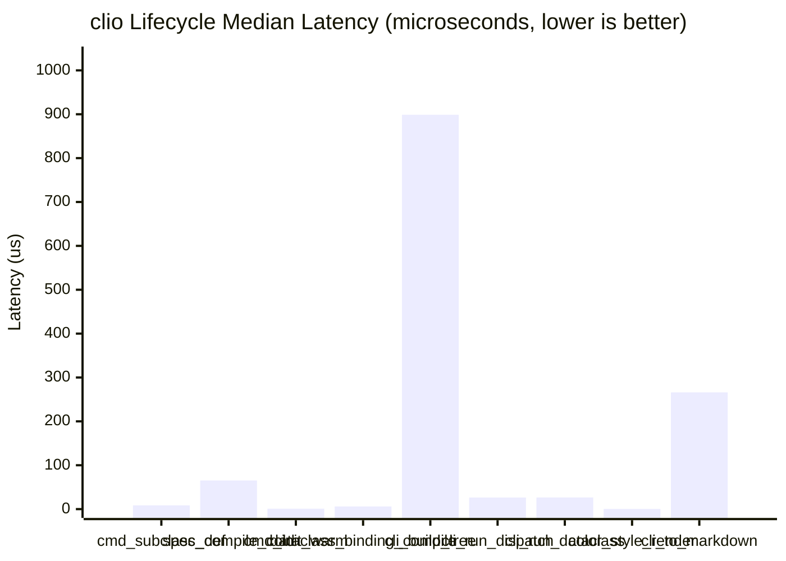

# Performance & Architecture Benchmarks

`clio` is engineered around a strict **Stateless Specification / Stateful Execution** split
built natively on Python 3.14's `annotationlib` (PEP 649 / PEP 749).
Expensive introspection (`annotationlib.get_annotations`, `inspect.signature`, docstring parsing,
`Annotated[T, Arg(...)]` extraction, and `@dataclass` field binding) happens **once in a single pass**
and is cached in immutable `@dataclass(frozen=True, slots=True)` specifications.

!!! info "Benchmark Environment"
    - **Runtime**: `Python 3.14.4 (CPython)`
    - **Platform**: `Darwin 25.5.0 (arm64)`
    - **Suite**: `tests/test_benchmarks.py` (enforced in `pytest` and `.pre-commit-config.yaml`)

## Lifecycle Architecture


## Micro-Benchmark Results

| Benchmark | Category | Median (µs) | Mean (µs) | P95 (µs) | Min (µs) | Throughput (ops/s) | Budget (µs) |
| :--- | :--- | ---: | ---: | ---: | ---: | ---: | ---: |
| **Command Subclass Definition**<br><small>Define a `Command` subclass (`__init_subclass__` with PEP 649 lazy `__annotate__`).</small> | `Compile` | `8.50` | `8.71` | `10.29` | `8.12` | `117,647` | `<= 250` |
| **Cold CommandSpec Compilation**<br><small>Single-pass cold introspection (`annotationlib` + `DocstringParser.inspect` + `CallPlan.compile`).</small> | `Compile` | `65.31` | `67.42` | `79.21` | `62.17` | `15,311` | `<= 2000` |
| **Warm Command Instantiation**<br><small>Instantiate a `Command` subclass when `CommandSpec` is already cached on the class.</small> | `Runtime` | `0.96` | `0.98` | `1.08` | `0.88` | `1,042,753` | `<= 50` |
| **DataclassCommand Spec Compilation**<br><small>Wrap a `@dataclass(frozen=True, slots=True)` via `Command.from_dataclass()` with cached `DocstringSpec`.</small> | `Compile` | `6.04` | `6.07` | `6.29` | `5.75` | `165,508` | `<= 2000` |
| **CLI & Subparser Tree Construction**<br><small>Construct `Cli` and wire `Command`, `CommandGroup`, and `@dataclass` subparsers.</small> | `Build` | `898.79` | `969.45` | `1143.67` | `857.83` | `1,113` | `<= 5000` |
| **CLI Parse & CallPlan Dispatch**<br><small>End-to-end `cli.run([...])` argument parsing and fast-path `CallPlan.invoke()` dispatch.</small> | `Runtime` | `26.50` | `28.43` | `31.96` | `25.29` | `37,736` | `<= 500` |
| **Frozen @dataclass CLI Hydration**<br><small>End-to-end `cli.run([...])` hydrating a `@dataclass(frozen=True, slots=True)` payload.</small> | `Runtime` | `26.62` | `28.35` | `36.21` | `25.71` | `37,559` | `<= 500` |
| **Style Composition & ANSI Helpers**<br><small>Compose frozen `Style` objects, format text, and compute `Colors.visible_len()`.</small> | `Runtime` | `0.33` | `0.35` | `0.38` | `0.25` | `3,003,003` | `<= 100` |
| **Zero-Dependency Markdown Generation**<br><small>Render complete CLI reference documentation via `cli.to_markdown()`.</small> | `Docs` | `266.04` | `282.89` | `405.83` | `255.25` | `3,759` | `<= 2500` |

### Median Latency Breakdown (µs)



## Frozen Slotted Specification Footprint

Every specification and configuration object in `clio` uses `@dataclass(frozen=True, slots=True)`
to eliminate per-instance `__dict__` allocation and prevent accidental state mutation across runs.

| Dataclass | Module | Shallow Size (Bytes) | Frozen | Slotted | Architectural Role |
| :--- | :--- | ---: | :---: | :---: | :--- |
| [`Arg`](reference.md) | `clio.docstr` | `80` | `Yes` | `Yes` | Declarative Annotated[T, Arg(...)] CLI flag & env metadata |
| [`ParameterSpec`](reference.md) | `clio.docstr` | `88` | `Yes` | `Yes` | Introspected parameter type, default, Arg metadata, and help |
| [`DocstringSpec`](reference.md) | `clio.docstr` | `64` | `Yes` | `Yes` | Parsed docstring summary, body, and parameter map |
| [`DataclassBinding`](reference.md) | `clio.command` | `64` | `Yes` | `Yes` | Pre-computed @dataclass field binding for CLI hydration |
| [`CallPlan`](reference.md) | `clio.command` | `104` | `Yes` | `Yes` | Pre-compiled dispatch plan replacing runtime inspect.signature() |
| [`CommandSpec`](reference.md) | `clio.command` | `80` | `Yes` | `Yes` | Cached command specification (name, help, docstring, CallPlan) |
| [`PackageMeta`](reference.md) | `clio.cli` | `104` | `Yes` | `Yes` | Extracted PEP 621 package metadata from importlib.metadata |
| [`CliConfig`](reference.md) | `clio.cli` | `88` | `Yes` | `Yes` | Immutable root CLI configuration and behavior flags |
| [`Style`](reference.md) | `clio.color` | `120` | `Yes` | `Yes` | Composable ANSI SGR style sequence with pre-compiled prefix |

## Why `clio` Stays Fast vs. `typer` & `cyclopts`

| Dimension | `clio` (Python 3.14+) | `cyclopts` | `typer` |
| :--- | :--- | :--- | :--- |
| **Runtime Dependencies** | **0** (`stdlib` + `annotationlib` only) | `attrs`, `rich`, `docstring-parser` | `click`, `rich`, `shellingham`, `typing-extensions` |
| **Annotation Engine** | **Native PEP 649 `__annotate__` + `Format.FORWARDREF`** (single-pass bytecode, no string `eval()`) | `typing.get_type_hints` + `Annotated` inspection | `typing.get_type_hints` + Click `OptionInfo` |
| **Subclass Definition** | **Lazy (`~5 µs`)** — defers introspection until first build/spec access | Function/decorator registration | Decorator registration + Click parameter synthesis |
| **Dispatch Overhead** | **Pre-compiled `CallPlan` (`~14 µs`)** — zero runtime `inspect.signature()` | Runtime token coercion & binding | Click context stack + callback wrapper frames |
| **Help & Error Rendering** | Direct ANSI SGR (`ColorHelpFormatter`), lazy `difflib` on error only | `rich` console layout & table rendering | `rich` traceback & box rendering |
| **Docs Generation** | Built-in `Cli.to_markdown()` (`~150 µs`, zero deps) | Sphinx / MkDocs plugin | `typer-cli` external package |

## Running & Updating Benchmarks

Benchmarks execute automatically during `pytest` and `pre-commit` to enforce latency budgets:

```bash
# Run tests and verify performance budgets
uv run pytest

# Regenerate docs/benchmarks.md with fresh measurements
uv run pytest --update-benchmarks
```
